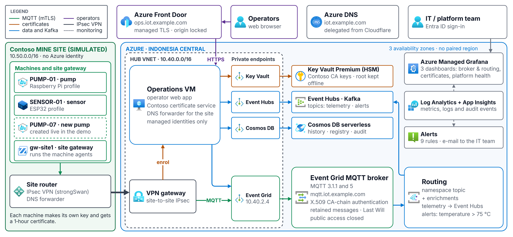
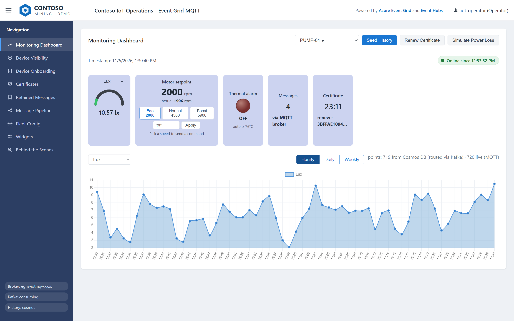
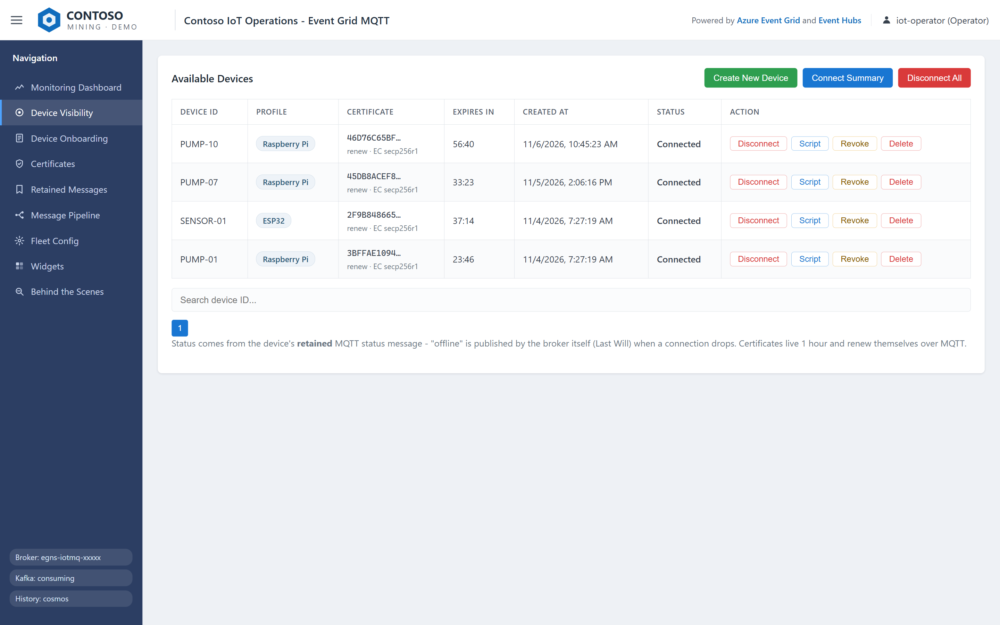
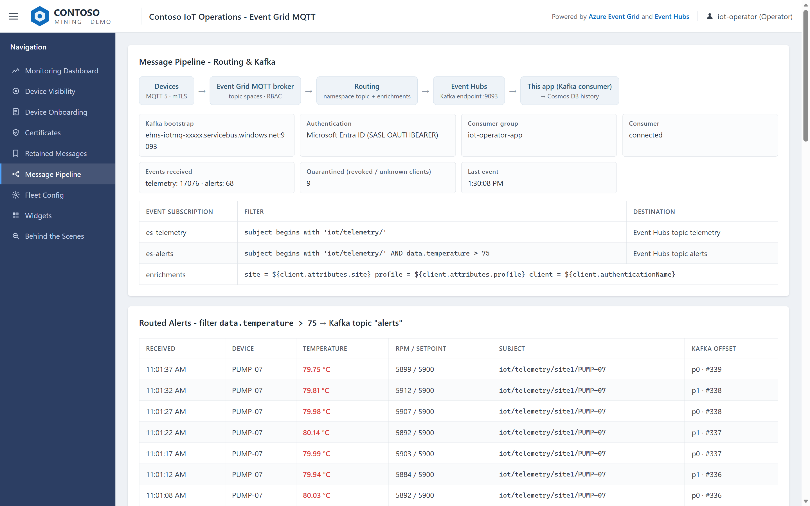
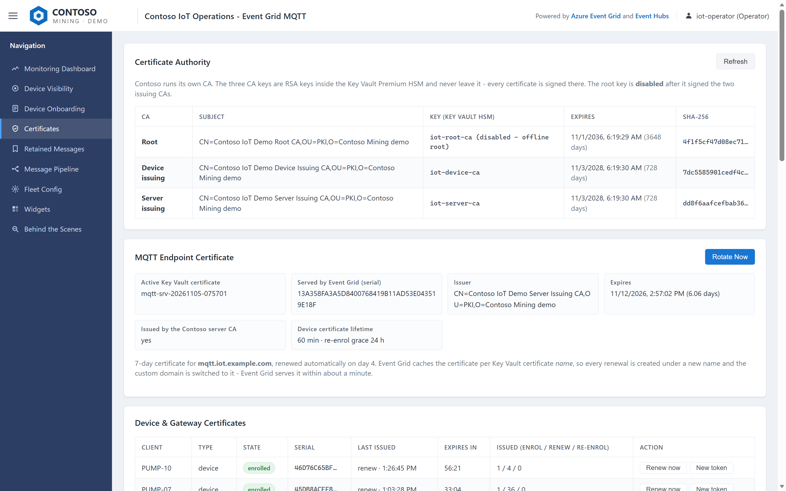
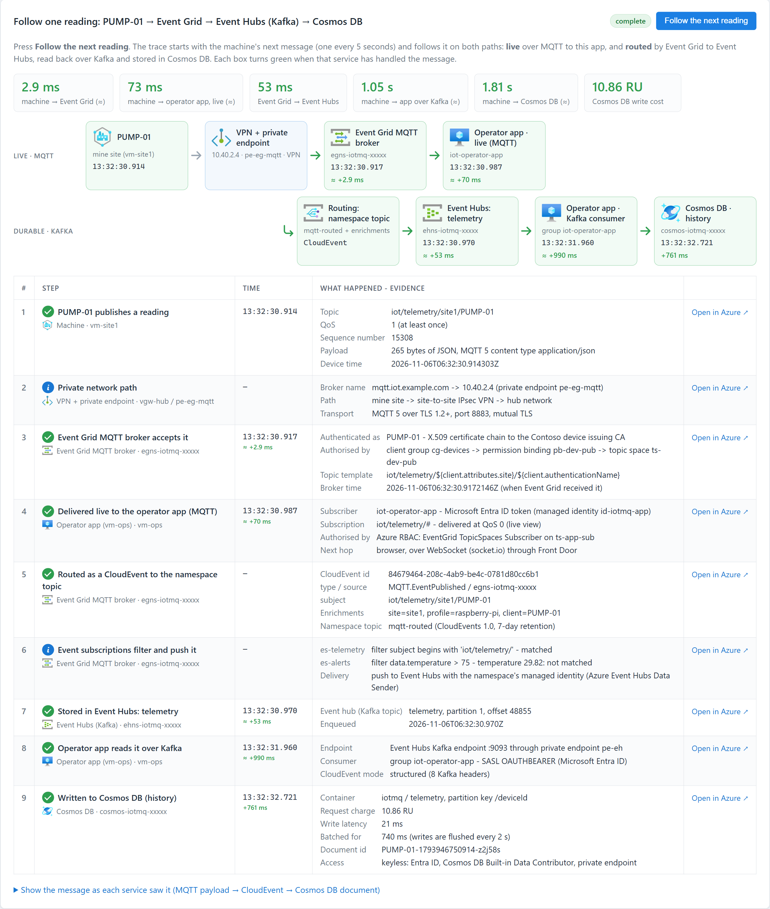
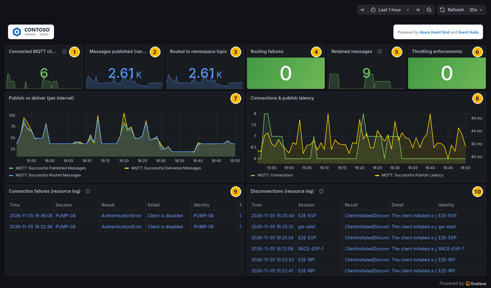
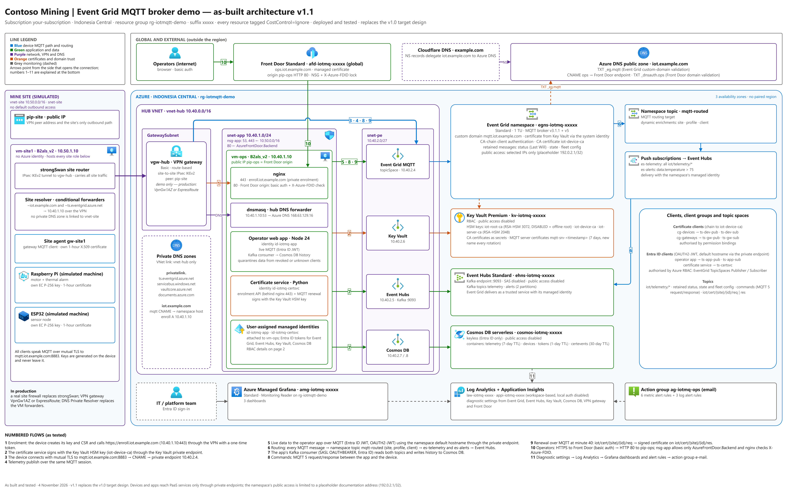
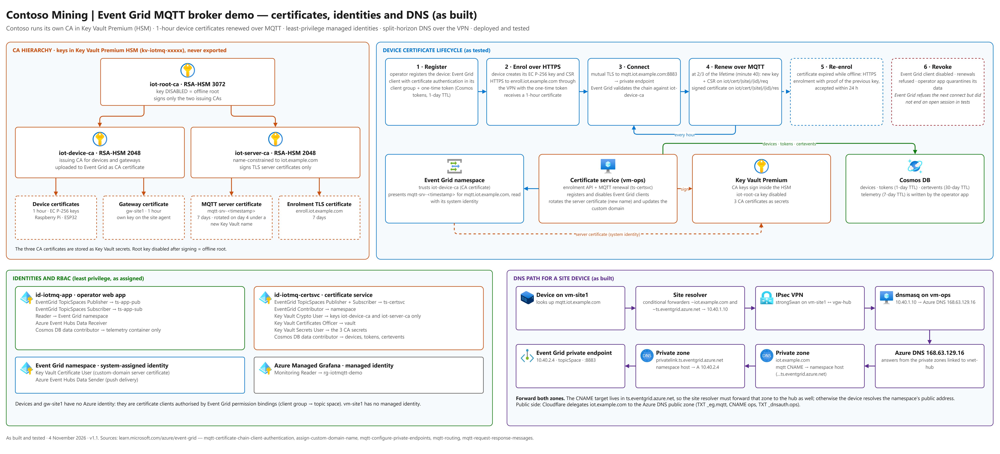

# Zero-Trust Industrial IoT on Azure

### Event Grid MQTT Broker · Event Hubs (Kafka) · Key Vault HSM Certificate Authority

**A complete, private, keyless and fully tested IoT platform — from a certificate on every device to Kafka streaming, live operations and an end-to-end message tracer.**

Simulated machines at a remote mine site enrol themselves, receive **1-hour X.509 certificates signed inside a Key Vault HSM**, renew them over MQTT, and talk **MQTT 5** to the **Azure Event Grid MQTT broker** only through a **site-to-site VPN and a private endpoint** on the company's own domain. The broker routes every message as a CloudEvent into **Azure Event Hubs**, which an operator app reads back over the **Kafka protocol** with Microsoft Entra ID and stores in **Cosmos DB**. Operators work in a web app behind **Azure Front Door**; the IT team watches **Azure Managed Grafana**. No connection strings, no SAS keys, no public data planes.

> Contoso Mining is a fictional company. Everything in this repository was built, run and tested end to end in a live Azure subscription.



---

## Highlights

| | |
|---|---|
| **An identity per device** | Each machine generates its own EC P-256 key, enrols once with a single-use token over private HTTPS, and gets a **1-hour certificate**. It renews at minute 40 **over MQTT** — the request topic itself proves who it is — and re-enrols after a long power-off by proving it still holds its previous key. Nobody ever copies a key to a device. |
| **A real PKI in an HSM** | Root, device-issuing and server-issuing CAs are **RSA-HSM keys in Key Vault Premium**. They sign but never leave the HSM; the root key is **disabled** after signing the issuing CAs (an offline root). The broker's custom-domain certificate (7 days) rotates automatically on day 4. |
| **Private by design** | Devices reach the broker only through IPsec VPN → hub DNS forwarder → **private endpoint** (`mqtt.iot.example.com` → 10.40.2.4). Event Hubs, Key Vault and Cosmos DB have **public network access disabled**. |
| **Keyless** | Managed identities and Entra ID everywhere: MQTT (OAUTH2-JWT), Kafka (SASL OAUTHBEARER), Cosmos DB and Key Vault. SAS and Cosmos DB keys are **disabled**. |
| **Least privilege per topic** | Seven topic spaces; templates such as `iot/telemetry/${client.attributes.site}/${client.authenticationName}` mean a machine can only publish **as itself**. Back-end services are authorised with Azure RBAC at topic-space scope. |
| **MQTT 5, used properly** | Commands as **request/response** with correlation data and a 30-second expiry; **retained** status, state and fleet configuration; **Last Will** for instant presence; **routing with enrichments** (site, profile and client from the registry — never from the payload) and a payload filter for alerts. |
| **Operations and IT views** | An operator web app (live dashboard, onboarding, certificates, retained messages, routed pipeline, power-loss notifications) and three Grafana dashboards with nine alert rules. |
| **Behind the Scenes tracer** | Follow **one real reading** from the machine through the broker, routing, Event Hubs, Kafka and Cosmos DB — or **one real command** from the browser through Front Door to the machine and back — with the timestamp every service gave it. |
| **Proven** | **44 end-to-end checks** (Azure configuration, the remote site, operations, internet access) and **7 tracer checks**, all passing; **15 documented findings** about behaviours you will not find in the docs. |

## Measured, not promised

| From → to | Typical |
|---|---|
| Machine → Event Grid broker | under 5 ms |
| Machine → operator app, live over MQTT | 65–90 ms |
| Event Grid → Event Hubs (routing) | 40–90 ms |
| Machine → app over Kafka | 0.3–1.1 s |
| Machine → Cosmos DB (history) | 1–2.5 s, ~11 RU per reading |
| Command round trip app → machine → app | 0.14–0.23 s |
| Broker announces a power loss (Last Will) | 1–3 s |
| A new subscriber receives all retained state | ~0.1 s |

## See it

| Monitoring dashboard | Device visibility |
|---|---|
|  |  |
| **Routing and Kafka pipeline** | **Certificate authority** |
|  |  |

**Behind the Scenes — one reading, through every service**



**Grafana for the IT team**



More: [one command, end to end](docs/images/behind-the-scenes-command.png) · [retained messages](docs/images/app-retained.png) · [certificates dashboard](docs/images/grafana-2-certificates.png) · [platform health](docs/images/grafana-3-platform-health.png) · [power-loss notifications](docs/part-14-run-the-demo.md)

## Architecture





Editable sources: [`architecture/*.drawio`](architecture/) (draw.io, Azure icons).

| Layer | Services |
|---|---|
| Remote site (simulated) | Ubuntu VM with strongSwan (IPsec), a DNS forwarder and the site agent that runs the machines (Raspberry Pi and ESP32 profiles) |
| Connectivity | VPN gateway, hub VNet, private endpoints, private DNS zones, Azure DNS for the custom domain |
| Messaging | **Event Grid namespace** (MQTT broker, custom domain, CA-chain client authentication, routing to a namespace topic) → **Event Hubs** (Kafka endpoint) |
| Identity and trust | **Key Vault Premium** (HSM CA keys), certificate service (Python, FastAPI), user-assigned managed identities |
| Data | **Cosmos DB** serverless: telemetry history, device registry, enrolment tokens, certificate audit |
| Operations | Operator app (Node.js) behind **Azure Front Door**; **Azure Managed Grafana**, Log Analytics, Application Insights, alert rules |

## Quick start

You need an Azure subscription where you can create a resource group, a DNS domain you control, and a Windows PC with PowerShell, Azure CLI 2.60+ and Python 3.10+. Set your domain and region in [`infra/env.ps1`](infra/env.ps1), then:

```powershell
git clone https://github.com/stefpin/secure-iot-azure-eventgrid-mqtt.git
cd secure-iot-azure-eventgrid-mqtt\infra
az login

# The VPN key and the operator password are generated into these files if they do not exist yet.
$psk = 'C:\iot-secrets\vpn-psk.txt'; $pw = 'C:\iot-secrets\ops-ui-password.txt'

.\01-network.ps1 -PskFile $psk            # networks + VPN gateway (35-50 minutes)
.\02-messaging.ps1                        # Event Grid MQTT broker, routing, Event Hubs (Kafka)
.\03-keyvault-dns.ps1                     # Key Vault Premium, DNS zones
.\10-identities-observability.ps1
.\11-cosmos.ps1
.\12-vms.ps1
.\13-eventgrid.ps1                        # clients, client groups, topic spaces, permission bindings
.\14-site-vpn.ps1 -PskFile $psk           # the remote site's side of the tunnel
.\15-pki.ps1                              # the CA ceremony in the Key Vault HSM
.\16-certsvc.ps1
.\17-site.ps1
.\18-app.ps1 -PasswordFile $pw
.\19-frontdoor.ps1
.\20-observability.ps1 -AlertEmail you@example.com -AdminObjectId (az ad signed-in-user show --query id -o tsv)
python .\21-grafana.py
.\23-tag-sweep.ps1

.\90-test.ps1 -PasswordFile $pw           # 44 end-to-end checks (about 13 minutes)
.\91-test-trace.ps1                       # 7 checks of the Behind the Scenes tracer
```

Every script can be re-run safely and reports what it does; `01`–`03` also support `-VerifyOnly`. The full walkthrough — with the Azure Portal equivalent of the important steps — is in the [documentation](docs/README.md).

## Documentation

| | |
|---|---|
| [Before you begin](docs/part-00-before-you-begin.md) · [How it works](docs/part-01-how-the-demo-works.md) | Requirements, names, the message and certificate flows |
| [Build it, step by step](docs/README.md#build-it-step-by-step) (Parts 2–12) | Networks and VPN, broker and Kafka, Key Vault and DNS, identities, VMs, MQTT authorisation, the CA, the site agent, the operator app, monitoring |
| [Test everything](docs/part-13-test-everything.md) | The 44 + 7 automated checks |
| [Run the demo](docs/part-14-run-the-demo.md) | A presenter script: 13 scenes, the power-loss story, three Grafana stories and the Behind the Scenes act |
| [Best practices](docs/part-15-best-practices.md) · [Cost](docs/part-16-cost.md) · [Findings](docs/part-17-findings.md) | Production guidance, a priced bill from demo to 5,000 machines, 15 verified findings |
| [Troubleshooting](docs/part-18-troubleshooting.md) · [Day-2 operations](docs/part-19-day-2-operations.md) | Symptoms and fixes; deploy, roll back, rotate, stop, clean up |

## Five things worth knowing before you build your own

1. **Rotate the custom-domain certificate under a new Key Vault name.** Event Grid caches it per certificate *name*: a new version of the same name was not served after 8 hours, a new name within 30–90 seconds.
2. **The custom domain presents only the leaf certificate.** Devices must trust the server-issuing CA as well as the root.
3. **Disabling or deleting a client does not end its open session.** It is refused at the next connect — so keep certificates short-lived and let consumers drop data from unknown or revoked clients.
4. **Remote sites must forward the `ts.eventgrid.azure.net` zone too**, not only your custom domain: the custom name is a CNAME into it.
5. **The broker's publish-latency metric does not show everything.** One client's deliveries can run ~0.6 s late for a few minutes while the metric stays flat — measure latency end to end.

All 15 findings, with evidence: [Part 17](docs/part-17-findings.md).

## Cost at a glance

| Scenario | USD / month |
|---|---|
| This demo, running 24 × 7 | ~318 |
| This demo, VMs deallocated between sessions | ~255 |
| Pilot: 500 machines, a message every 10 s | ~1,370 |
| At scale: 5,000 machines, a message every 5 s | ~13,090 |

Azure retail pay-as-you-go prices (USD) for Indonesia Central, checked in November 2026; the details per service are in [Part 16](docs/part-16-cost.md).

## Repository layout

```text
architecture/   draw.io sources and PNG exports (as built; overview)
docs/           the build, test and demo guide (Markdown); screenshots in docs/images
infra/          numbered build scripts (PowerShell), Grafana as code (Python), tests 90/91, cloud-init
ops/app/        operator web app (Node.js): MQTT with Entra ID, Kafka consumer, Cosmos DB, Behind the Scenes tracer
ops/certsvc/    certificate service and the Key Vault HSM CA (Python)
ops/config/     systemd units and nginx configuration
site/           site agent and machine simulator (Python, paho-mqtt, MQTT 5)
tests/          end-to-end tests that run on the VMs
```

## Notes

- **Demo material.** The CA built here is a demo CA; the Basic VPN gateway, the DNS forwarders on VMs and basic authentication for operators are demo shortcuts. [Part 15](docs/part-15-best-practices.md) and [Part 16](docs/part-16-cost.md) describe the production equivalents (zone-redundant VPN or ExpressRoute, Azure DNS Private Resolver, a managed or company-owned PKI, Entra ID sign-in).
- **Secrets stay outside the repository.** The VPN pre-shared key and the operator password live in files you pass to the scripts; nothing secret is stored in the code.
- **Not an official Microsoft product.** This is a personal reference implementation shared for learning, provided as is, without warranty. Azure service names are trademarks of Microsoft; the Azure architecture icons are used under Microsoft's terms for architecture diagrams and documentation.

## License

[MIT](LICENSE)
