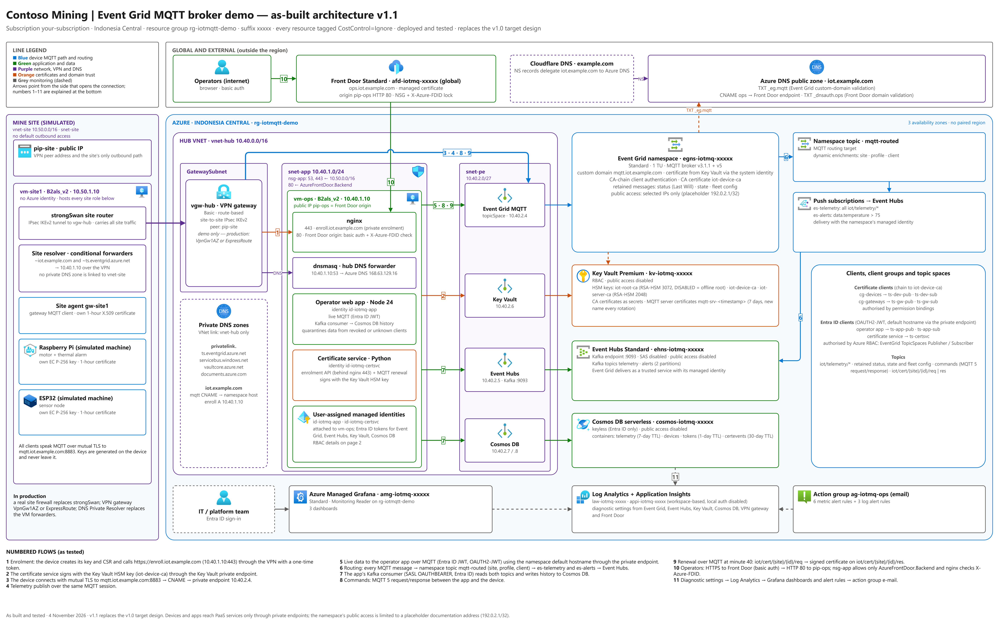

# Part 1 — How the demo works

[Documentation index](README.md) · [← Part 0 — Before you begin](part-00-before-you-begin.md) · [Part 2 — Prepare your computer →](part-02-prepare-your-computer.md)

Figure 1 shows the demo as built. Read it from left to right: machines at the mine site, the VPN, the hub network with the broker's private endpoint, the cloud services, and the two audiences on the right — operators in the web app and the IT team in Grafana.

*Figure 1 — The demo as built (editable source: architecture/iot-eventgrid-mqtt-as-built.drawio, page 1)*

## 1.1 The path of one telemetry message

1. A machine at the mine site publishes a JSON reading every 5 seconds to `iot/telemetry/site1/<id>` on `mqtt.iot.example.com:8883`, using mutual TLS with its own 1-hour certificate.
2. The site's resolver sends that name to the hub DNS forwarder (10.40.1.10) through the VPN; the answer is the private endpoint **10.40.2.4**. The broker's public endpoint is closed to everything except a placeholder IP.
3. The broker checks the certificate against the registered **device issuing CA**, matches its common name to the Event Grid client, and checks the client group's permission to publish on that topic.
4. Subscribers receive the message at once — the operator app shows it live (about 0.2 seconds end to end).
5. **Routing** also copies the message, as a CloudEvent with the enrichments `site`, `profile` and `client`, into the namespace topic `mqtt-routed`. The subscription `es-telemetry` delivers it to Event Hubs `telemetry`; `es-alerts` delivers only readings with `data.temperature > 75` to `alerts`.
6. The app reads both Event Hubs through the **Kafka** protocol and stores the history in Cosmos DB. The charts merge the live and stored points.

## 1.2 The components

| Component | What it does | Security |
|---|---|---|
| Event Grid namespace (Standard, 1 TU) | MQTT 3.1.1 + 5 broker, retained messages, Last Will, routing | Public access: selected IPs only; private endpoint; custom domain with Contoso certificate |
| Event Hubs (Standard) | Kafka endpoint for routed data (`telemetry`, `alerts`) | No SAS keys, no public access; Event Grid delivers as a trusted service with managed identity |
| Key Vault Premium | HSM keys of the Contoso CA; CA certificates; MQTT server certificates | RBAC per key/secret; public access disabled; root key disabled |
| Cosmos DB (serverless) | Telemetry history (7 days), device registry, one-time tokens, certificate audit trail | No keys, no public access; data roles per container |
| vm-ops (B2als_v2) | Operator app (Node 24), certificate service (Python), nginx, DNS forwarder | Two user-assigned identities; port 80 open to Front Door only; 443 and 53 to the site only |
| vm-site1 (B2als_v2) | The simulated mine site: IPsec, site resolver, site agent, machines | No Azure identity — only certificates |
| VPN gateway (Basic) + strongSwan | IKEv2 site-to-site tunnel 10.50.0.0/16 ↔ 10.40.0.0/16 | Pre-shared key; site NSG accepts IPsec only from the gateway |
| Azure Front Door (Standard) | `ops.iot.example.com` with a managed TLS certificate | Origin accepts only this Front Door profile (`X-Azure-FDID`) plus basic auth |
| Log Analytics, Application Insights, Managed Grafana | Metrics, resource logs, certificate-service telemetry, dashboards, alerts | Entra-only ingestion; Grafana reads with Monitoring Reader |

## 1.3 Topics and who may use them

| Topic | Publisher | Subscriber | Retained |
|---|---|---|---|
| `iot/telemetry/{site}/{id}` | the machine | operator app; routed to Kafka | no |
| `iot/status/{site}/{id}` | the machine (online) or the broker's **Last Will** (offline) | operator app | **yes** |
| `iot/state/{site}/{id}` | the machine (profile, setpoint, certificate) | operator app | **yes** |
| `iot/cmd/{site}/{id}/{method}` | operator app (MQTT 5 request) | the machine | no — expires in 30 s |
| `iot/cmdres/{site}/{id}` | the machine (MQTT 5 response) | operator app | no |
| `iot/cert/{site}/{id}/req` · `/res` | machine ↔ certificate service | certificate service ↔ machine | no |
| `iot/config/fleet` | operator app | every machine and gateway | **yes** |
| `iot/site/{site}/sim/req` · `/res` | operator app ↔ site gateway | site gateway ↔ operator app | no |

`{site}` and `{id}` are not trusted from the client: the broker fills them from the client's own attribute `site` and authentication name. A machine therefore **cannot** publish as another machine or read another machine's commands.

## 1.4 The certificate lifecycle in one paragraph

An operator registers a machine; the certificate service creates its Event Grid client and a **one-time token** (24 hours). On first start the machine generates its own key, sends a certificate signing request with the token over private HTTPS, and receives a **1-hour** certificate signed by the Contoso device CA inside the Key Vault HSM. At minute 40 it asks for a new one over MQTT — the request topic itself proves who it is — swaps the files atomically and reconnects. If it was offline long enough for the certificate to expire, it re-enrols within 24 hours by proving it still holds the previous key. Nobody ever copies a key or certificate file to a device.

---

[Documentation index](README.md) · [← Part 0 — Before you begin](part-00-before-you-begin.md) · [Part 2 — Prepare your computer →](part-02-prepare-your-computer.md)
