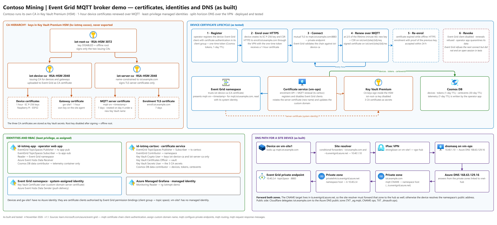

# Part 9 — Contoso's own certificate authority

[Documentation index](README.md) · [← Part 8 — Who may connect and publish what](part-08-mqtt-authorisation.md) · [Part 10 — The mine-site agent and the machines →](part-10-site-agent-and-machines.md)

Contoso runs its own private CA (option A). The demo's CA is for the demo only; production gets a new CA built the same way.

#### Do it with the script

*PowerShell — about 10 minutes*

```powershell
.\15-pki.ps1
.\16-certsvc.ps1
```



*Figure 2 — Certificates, identities and DNS as built (same .drawio file, page 2)*

## 9.1 The key ceremony (15-pki.ps1)

| Key in Key Vault (HSM) | Certificate | Lifetime | Signs |
|---|---|---|---|
| `iot-root-ca` RSA-HSM 3072 — **disabled** after use | Contoso IoT Demo Root CA (self-signed) | 10 years | the two issuing CAs, nothing else |
| `iot-device-ca` RSA-HSM 2048 | Contoso IoT Demo Device Issuing CA | 2 years | machine and gateway certificates (1 hour) |
| `iot-server-ca` RSA-HSM 2048 | Contoso IoT Demo Server Issuing CA, **name-constrained** to iot.example.com | 2 years | the MQTT endpoint and enrolment endpoint certificates (7 days) |

How a certificate is signed without the key ever leaving the HSM: the service builds the certificate's *to-be-signed* part locally, asks Key Vault to sign its SHA-256 digest (RS256), and splices the signature in — then verifies the result against the CA's public key before using it.

1. The script gives the certificate-service identity **temporary** rights to create keys and secrets.
2. It runs `bootstrap.py` on vm-ops: three HSM keys, the three CA certificates (stored as Key Vault secrets and in `/etc/iot/pki`), then **disables the root key**, then issues the enrolment endpoint's TLS certificate.
3. It copies the **public** CA certificates to `pki\` and builds `trust-bundle.pem` = root CA + server issuing CA.
4. It registers the device issuing CA with Event Grid (**MQTT broker → CA certificates**).
5. It removes the temporary rights and grants only: *Crypto User* on the two issuing keys, *Secrets User* on the three CA certificates, *Certificates Officer* on the vault.

> [!NOTE]
> **Two Event Grid details we found**
>
> **CA certificate format:** the CA certificate API rejects a standard PEM with 64-character lines ("must be in valid PEM format"). It accepts the header, the base64 body as **one line**, and the footer, separated by CRLF. The script does this.
>
> **Only the leaf is served:** the MQTT endpoint presents only its own certificate, not the issuing CA, even though Key Vault holds the full chain. Devices therefore need the root **and** the server issuing CA in their trust bundle.

## 9.2 The certificate service (16-certsvc.ps1)

| Interface | Where | Purpose |
|---|---|---|
| `POST /v1/enroll` | nginx 10.40.1.10:443, private DNS only | first certificate: one-time token + CSR |
| `POST /v1/reenroll` | same | expired certificate: proof of the previous key within 24 h |
| MQTT `iot/cert/+/+/req` | Entra ID client of the broker | renewal before expiry, answered on `…/res` |
| `/internal/*` | 127.0.0.1:8081 + shared header token | registry, tokens, revoke/restore, CA info, server certificate — used by the operator app |
| Scheduler (every 10 min) | inside the service | rotate the MQTT server certificate on day 4 of 7; renew the enrolment certificate; prune old certificates |

> [!WARNING]
> **Event Grid caches the server certificate by NAME**
>
> We measured it: a **new version** of the same Key Vault certificate was **not** served after 8 hours, and a *versioned* certificate URL is rejected ("Only unversioned URL are supported"). Switching the custom domain to a certificate **name** Event Grid had never used was served within about **30–90 seconds**; switching back to an older name served the old cached version.
>
> So every rotation is issued under a **new name** (`mqtt-srv-YYYYMMDD-HHMMSS`) through a Key Vault CSR (the private key is generated in Key Vault), then the custom domain is switched to it and the service checks the served serial. The 7-day certificate is rotated with 3 days left, leaving ample time to react.

On first start the service issues the first MQTT server certificate itself. On a brand-new build `16-certsvc.ps1` then adds the Event Grid ownership record `_eg.mqtt` (TXT) to the public zone and asks Event Grid to validate the domain.

> [!IMPORTANT]
> **Checkpoint — do not continue until this is true**
>
> `16-certsvc.ps1` prints a HEALTH line with `"mqtt":{"connected":true`, a SERVER line with `"servedByIotCa":true`, an ENROLL line with `"status":"ok"`, and **Approved** for the custom domain.

---

[Documentation index](README.md) · [← Part 8 — Who may connect and publish what](part-08-mqtt-authorisation.md) · [Part 10 — The mine-site agent and the machines →](part-10-site-agent-and-machines.md)
