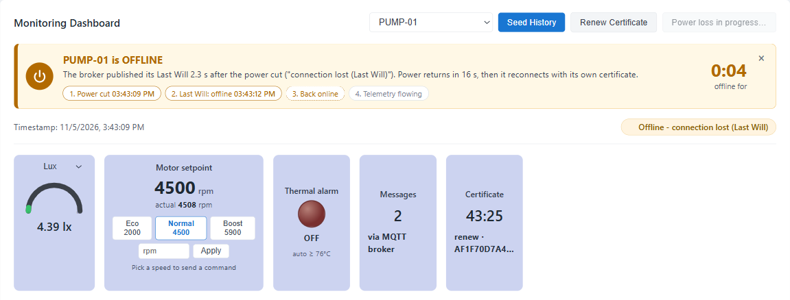
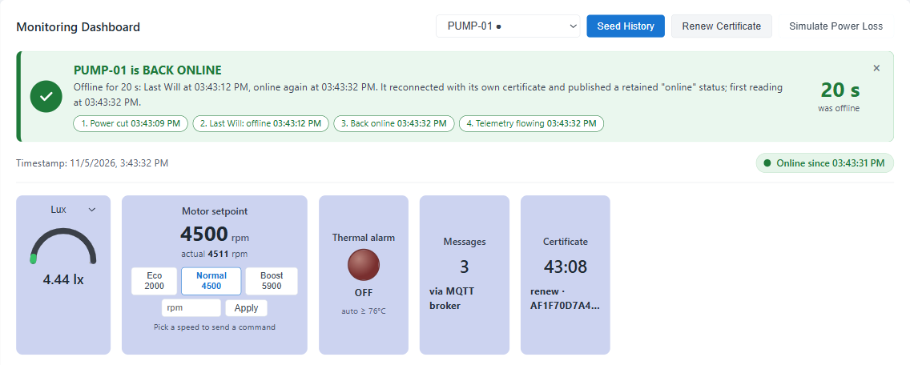
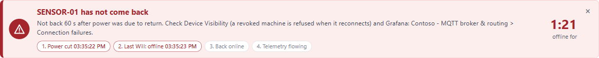
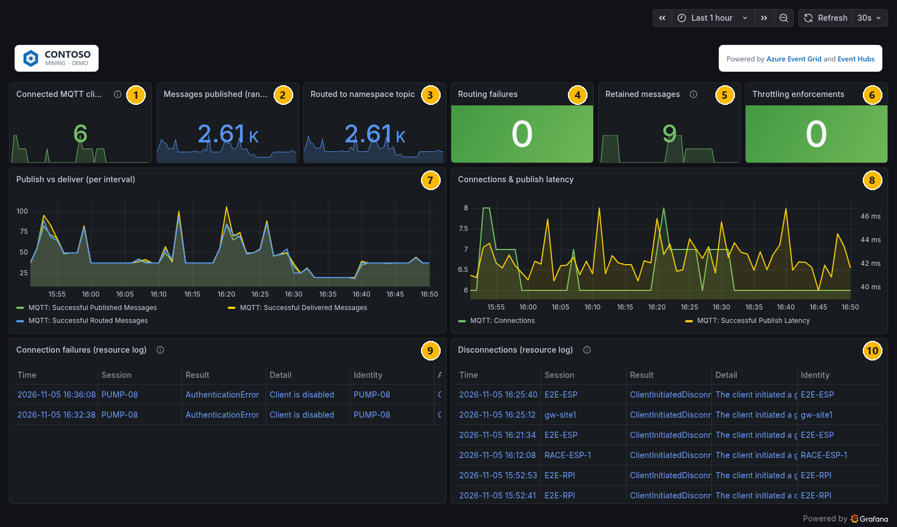
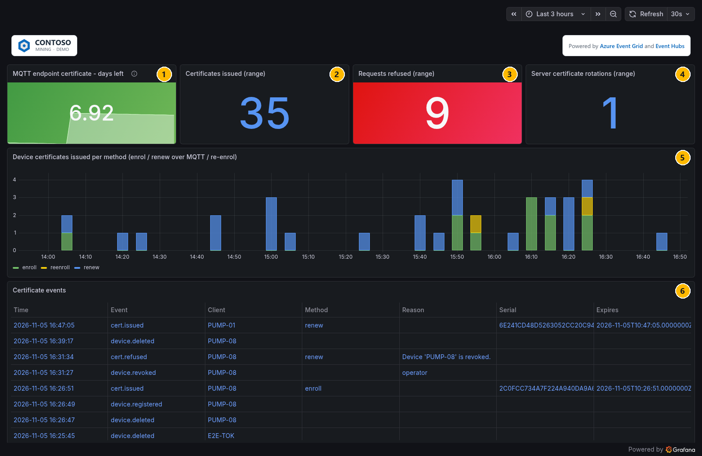
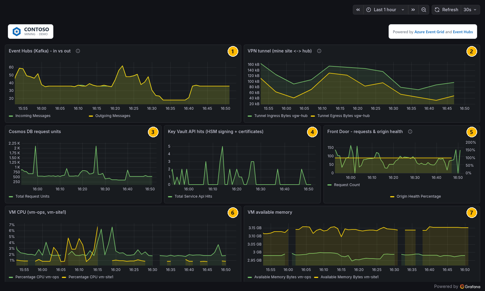
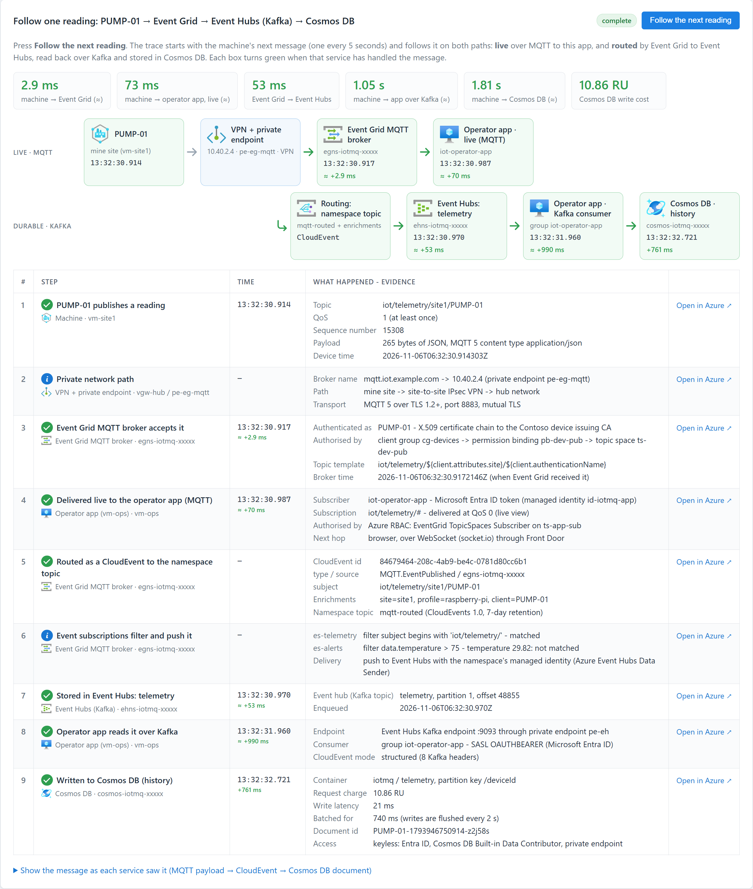
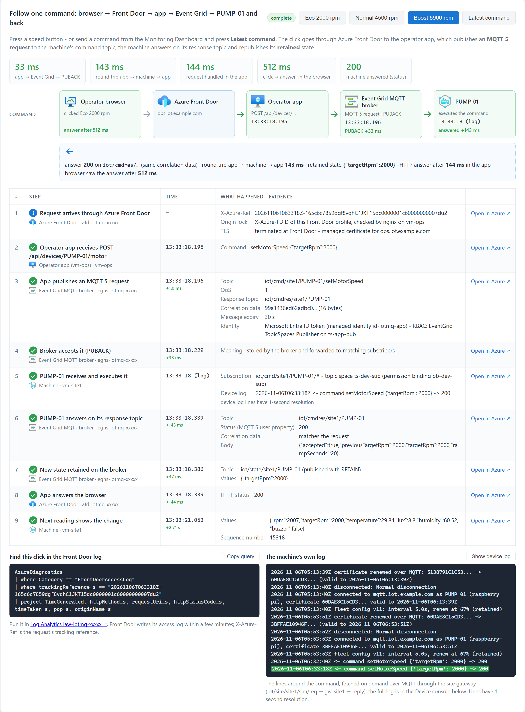

# Part 14 — Run the demo (presenter script)

[Documentation index](README.md) · [← Part 13 — Test everything](part-13-test-everything.md) · [Part 15 — Best practices for the Event Grid MQTT broker →](part-15-best-practices.md)

About 25 minutes for the operator app alone, about 35 minutes with the three Grafana stories, and about 47 minutes with the **Behind the Scenes** act (Part 14.9–14.14) that shows what each Azure service does with one message. Use two browser tabs: the **operator app** (tab 1) for the machines and **Grafana** (tab 2) for the IT view — plus, for the act, the Behind the Scenes page (tab 3), the Azure portal (tab 4) and Log Analytics (tab 5, optional). Prepare them before the audience arrives.

| Before you start (10 minutes) | How to check |
|---|---|
| Both VMs are running | Portal → **Virtual machines** → `vm-ops` and `vm-site1` show **Running**. If they show *Stopped (deallocated)*, select **Start** on both and wait 3 minutes. |
| The operator app works | Open `https://ops.iot.example.com`, sign in as `iot-operator` (password: the file you passed to `18-app.ps1 -PasswordFile`). |
| The two standing machines are online | **Device Visibility**: **PUMP-01** and **SENSOR-01** show **Connected** (press **Connect** if not). If a **PUMP-07** is left over from an earlier run, press **Delete** on it. |
| The fleet runs at its normal pace | **Fleet Config** shows a telemetry interval of **5 s** (set it and press **Publish (retained)** if not). |
| Grafana is ready in tab 2 | Follow Part 14.3. |

## 14.1 The operator-app script (13 scenes)

| # | Do this | Say this / what they see |
|---|---|---|
| 1 | **Device Visibility**. Point at STATUS and EXPIRES IN. | "Every machine has its own 1-hour certificate — watch the countdown. Status comes from a *retained* MQTT message, not from polling." |
| 2 | **Create New Device** → `PUMP-07`, Raspberry Pi → **Add Device**. | An Event Grid client is created and a **one-time token** appears. "This token is the only thing a technician brings; the key is generated on the machine." |
| 3 | **Show me the script**, scroll through it, then go back and press **Connect** on PUMP-07. | The site agent starts the machine at the mine site; within ~30 s it shows **Connected** and a certificate with method *enroll*. |
| 4 | **Monitoring Dashboard** → PUMP-07 → **Eco 2000**, then **Boost 5900**. | "accepted · 4500 → 2000 · ~200 ms" — an MQTT 5 request/response through the broker. With Boost the temperature climbs and the alarm LED trips by itself. |
| 5 | Type `9999` → **Apply**. Switch to SENSOR-01 and try a preset. | "rejected by device · 400" and, on the ESP32, "404 This device has no motor" — the device polices itself. |
| 6 | Back on PUMP-07: **Renew Certificate**. | Within a second the certificate widget resets to ~60:00 with a new serial. "Renewal happens automatically at minute 40 — no files, no technician." |
| 7 | **Certificates** page → **Rotate Now** (optional). | A new 7-day endpoint certificate is issued in Key Vault and served by Event Grid in about 30 seconds. Point at the root CA: *disabled*. |
| 8 | **Monitoring Dashboard** → PUMP-07 → **Simulate Power Loss**. Do not touch anything for 30 seconds. | The banner walks through the outage (Part 14.2): **OFFLINE** within ~2 s — the broker published the machine's Last Will — then a countdown, then a green **PUMP-07 is BACK ONLINE · was offline ~20 s** and a pop-up. "Nobody polled the machine: the broker announced that it was gone, and the machine announced that it was back." |
| 9 | **Message Pipeline** while PUMP-07 is on Boost. | Live CloudEvents from **Kafka** with enrichments `site/profile/client`; the *Routed Alerts* table fills when temperature > 75 — a routing filter, no code. |
| 10 | **Retained Messages → Run Late-Joiner Test**. | "A brand-new subscriber received 9 retained messages within ~0.1 s" — instant state for any new consumer. |
| 11 | **Fleet Config** → interval `10` → **Publish (retained)**. | Every machine applies it at once; machines that are offline get it when they reconnect. (Grafana shows the message rate halving — Story 1.) |
| 12 | **Device Visibility** → **Revoke** PUMP-07. Then on the **Monitoring Dashboard** (PUMP-07): **Renew Certificate**, and **Simulate Power Loss**. | Its Event Grid client is disabled, the renewal is **refused**, and its in-flight data is **quarantined** (Message Pipeline). After the power cut the banner turns red after ~80 s: **PUMP-07 has not come back** — the broker refuses the revoked machine (*Client is disabled*). "Revocation takes effect at the next connect — [Part 17](part-17-findings.md), finding 3." |
| 13 | Switch to **Grafana** (tab 2) and run the stories in 14.4–14.6 — or interleave them with the scenes as in 14.7. | "The IT team sees all of this without the operator app." |

> [!TIP]
> **After the demo**
>
> Delete PUMP-07 (it removes the client, the key at the site and its retained messages, and stops a revoked machine's reconnect attempts), set the fleet interval back to **5** seconds, and leave the Grafana tabs on *Last 1 hour*.

## 14.2 The power-loss notification

**Simulate Power Loss** tells the selected machine to drop its MQTT connection without a clean goodbye and to stay off for 20 seconds, like a machine whose power is cut. The broker then publishes the machine's **Last Will** — the retained *offline* status it left with the broker when it connected. Since version 1.1 the Monitoring Dashboard shows a banner that follows the whole outage, so the audience can see exactly when the machine is back. The banner appears in every open browser and survives a page reload; an **online / offline** status next to the timestamp always shows the selected machine's retained status.



*Figure 3 — During the outage: the Last Will arrived 2.3 s after the power cut; the countdown shows when power returns*

| Banner | What happened | What to say |
|---|---|---|
| **Blue** — *Power cut sent to PUMP-07* | The command was accepted; the machine is about to drop its connection. | "We cut the power — no clean goodbye." |
| **Amber** — *PUMP-07 is OFFLINE*, a countdown and an *offline for* timer | The broker published the machine's Last Will, normally 1–3 s after the cut. The status next to the timestamp turns amber: *Offline - connection lost (Last Will)*. | "The broker announced the outage on the machine's behalf. Every subscriber — this app, a SCADA system, anything — knows within seconds." |
| **Green** — *PUMP-07 is BACK ONLINE*, *was offline 20 s*, plus a green pop-up | The machine reconnected with **its own certificate** and published a retained *online* status; step 4 shows the first new reading. | "It came back by itself and authenticated with its certificate — no operator action." |
| **Red** — *PUMP-07 has not come back* | Not back 60 s after power was due to return (or no Last Will within 30 s). | "Something prevents the reconnection" — in scene 12 it is the revocation. Check **Device Visibility** and Grafana → *Connection failures*. |

The four steps under the headline — **1. Power cut · 2. Last Will: offline · 3. Back online · 4. Telemetry flowing** — fill in with their times as they happen.



*Figure 4 — Back online after 20 s, with the time of each step and the first new reading*



*Figure 5 — A machine that cannot come back (here: revoked during the outage) turns the banner red*

> [!TIP]
> **Good to know**
>
> **Simulate Power Loss** is greyed out (*Power loss in progress…*) for that machine until it is back. The green banner disappears after 3 minutes, or click **×**.
>
> The banner is driven by the machine's retained status messages, so it never misses an outage. Grafana is not the right place for this moment: the broker's disconnection log and the connection-count metric can both miss a 20-second outage ([Part 17](part-17-findings.md), findings 9 and 11).
>
> The same information is available to scripts: `GET /api/power-loss` returns each outage with its timestamps.

## 14.3 Prepare Grafana — the second screen

1. In a second browser tab open the Grafana address from [Part 0.4](part-00-before-you-begin.md) and select **Sign in with Microsoft**. Use the account that has a Grafana role on `amg-iotmq-xxxxx` (the account you gave a Grafana role in Part 12).
2. Left menu → **Dashboards** → folder **Contoso IoT - Event Grid MQTT**. Open **Contoso - MQTT broker & routing**, **Contoso - Certificates** and **Contoso - Platform health**, each in its own tab (**Ctrl + click**).
3. In each tab, open the time picker at the top right and choose **Last 1 hour** (broker and platform) or **Last 3 hours** (certificates). Leave the refresh at **30s**.
4. Optional, for a clean screen: add `&kiosk` to the end of the address (or `?kiosk` if it has no `?`) to hide the menus — press **Esc** to leave. A browser zoom of 80–90 % shows a whole dashboard.
5. Hover over the **ⓘ** next to a panel title to read what that panel shows.

| Kind of data | Shows up in Grafana after | Panels |
|---|---|---|
| Metrics | about 1 minute | all charts and the counters in the top row |
| Certificate events (Application Insights) | 10–40 seconds | Certificates: issued, refused, rotations, per method, events |
| Event Grid resource logs | 1–2 minutes | Connection failures, Disconnections |
| VPN gateway metrics | 5–10 minutes (5-minute grain) | VPN tunnel |

> [!TIP]
> **Do not wait in silence**
>
> Press the circular-arrow **Refresh** button at the top right to skip the 30-second wait, and talk through the panel that is already up to date while the next one catches up.

> [!IMPORTANT]
> **Checkpoint — do not continue until this is true**
>
> Each dashboard starts with the Contoso Mining banner; *Connected MQTT clients* shows **5** (two machines, the site gateway, the operator app and the certificate service) — **6** once PUMP-07 is connected; *MQTT endpoint certificate - days left* is green.

## 14.4 Story 1 — Contoso - MQTT broker & routing

**The question it answers:** *is the broker healthy, and can the IT team see every machine come and go — without the operator app?* About 6 minutes. The numbers in Figure 6 match the first column below.



*Figure 6 — Contoso - MQTT broker & routing, last hour of a rehearsal: fleet interval 10 s from 16:29 to 16:39 (panel 7 halves), a revoked test machine refused at 16:32 and 16:36 (panel 9)*

| # | Panel | Do this | What they see / say this |
|---|---|---|---|
| 1 | Connected MQTT clients | After scene 3 | **5 → 6** when PUMP-07 connects (within a minute), back to 5 when you delete it. "Every client is an Event Grid client with its own identity: machines, the site gateway, our app and the certificate service." |
| 2, 3 | Messages published · Routed to namespace topic | — | The two numbers are the same. "Every message the machines publish is also routed — copied as a CloudEvent into the namespace topic that feeds Kafka." |
| 4, 6 | Routing failures · Throttling enforcements | — | Green **0**. "These are the two numbers the platform team alerts on ([Part 12](part-12-monitoring-for-it.md)). One throughput unit has plenty of headroom for this fleet." |
| 5 | Retained messages | Scene 10 | **7** before PUMP-07, **9** with it: the last status and state of every machine and of the gateway, plus the fleet configuration. "A new consumer gets all of them instantly — that is the Late-Joiner test." |
| 7 | Publish vs deliver | Scene 11 (interval 10) | Within about 2 minutes the lines drop to half. "One retained message reconfigured the whole fleet, including machines that were offline." Published = machines → broker; delivered = broker → subscribers such as the operator app; routed = broker → Kafka. |
| 8 | Connections & publish latency | — | Publish latency about **40 ms**. "The broker accepts a machine's message in about 40 milliseconds, over the private endpoint." |
| 9 | Connection failures | Scene 12 (revoke, then power loss) | Within 1–2 minutes: **PUMP-07 · AuthenticationError · Client is disabled**. "The revoked machine can never reconnect — the broker refuses it." The log records some of the retries, not every one. |
| 10 | Disconnections | — | Explain the codes: *ClientInitiatedDisconnect* = the client said goodbye (certificate renewals reconnect about every 40 minutes; the simulated power loss also says goodbye, with MQTT 5 reason code 0x04 *disconnect with Will*). *KeepAliveTimeout* = a real power or network loss, noticed after 45 s. The broker logs disconnects best effort. |

## 14.5 Story 2 — Contoso - Certificates

**The question it answers:** *who looks after thousands of device certificates?* Nobody — they renew themselves, and every step is audited. About 5 minutes. Figure 7.



*Figure 7 — Contoso - Certificates, last 3 hours: renewals all along, the test runs' enrolments and re-enrolments, and a refused renewal from a revoked machine at the top of the events*

| # | Panel | Do this | What they see / say this |
|---|---|---|---|
| 1 | MQTT endpoint certificate - days left | Scene 7 (optional) | About **6.9** just after a rotation, falling to 3 before the automatic rotation on day 4. Green ≥ 3.5, amber 2–3.5, red &lt; 2 — and an alert fires below 2. After **Rotate Now** it jumps back to ~7 within a few minutes and panel 4 counts one more rotation. |
| 2 | Certificates issued (range) | — | "Every client gets a new 1-hour certificate about every 40 minutes, over MQTT — some 35 per client per day, with no technician and no file copied." |
| 5 | Device certificates issued per method | Scenes 3 and 6 | A green **enroll** bar when PUMP-07 gets its first certificate with its one-time token; blue **renew** bars for every renewal over MQTT, including the one you press in scene 6; a yellow **reenroll** bar when a machine that was off past expiry proves it still holds its previous key. |
| 6 | Certificate events | Scenes 6 and 12 | The audit trail — event, client, method, reason, serial, expiry. After scene 12: **cert.refused · PUMP-07 · renew · Device 'PUMP-07' is revoked.** |
| 3 | Requests refused (range) | Scene 12 | Turns **amber** at 1 and **red** at 6; an alert fires above 5 in 15 minutes (cloned or misconfigured devices). "A revoked machine can never get another certificate, and the one it has expires within the hour." |
| 4 | Server certificate rotations (range) | — | About every 4 days in normal operation (the certificate service rotates when 3 of the 7 days remain), plus any **Rotate Now**. Each rotation uses a new Key Vault certificate name ([Part 17](part-17-findings.md), finding 1). |

## 14.6 Story 3 — Contoso - Platform health

**The question it answers:** *what does the platform around the broker look like, and is anything struggling?* About 4 minutes. Figure 8.



*Figure 8 — Contoso - Platform health, last hour: Kafka in and out on top of each other, the VPN carrying the site's traffic, small HSM spikes for certificate signing*

| # | Panel | Do this | What they see / say this |
|---|---|---|---|
| 1 | Event Hubs (Kafka) - in vs out | Scene 11 | The two lines lie on top of each other: every routed message is read by the Kafka consumer (the operator app). "If *out* falls below *in*, a consumer is lagging." Both halve about 2 minutes after the interval change. |
| 2 | VPN tunnel (mine site &lt;-> hub) | — | "The mine site talks to Azure only through this tunnel." 5-minute grain, so changes show after 5–10 minutes; an alert fires if it is silent for 15 minutes. |
| 3 | Cosmos DB request units | — | The history store is serverless — you pay per request unit; the steady line is the routed telemetry being saved. |
| 4 | Key Vault API hits | Scenes 6–7 | "Every certificate is signed inside the HSM" — the small spikes are enrolments, renewals and rotations. The CA keys never leave Key Vault. |
| 5 | Front Door - requests & origin health | — | The operator app is published through Front Door with a managed certificate; origin health stays at **100 %**. "The VM itself cannot be reached from the internet." |
| 6, 7 | VM CPU · VM available memory | — | Two small VMs run the app, the certificate service and the simulated site at 1–5 % CPU with about 3 GB of memory free. |

## 14.7 Putting it together — one 35-minute run with two screens

| Time | Operator app (tab 1) | Grafana (tab 2) |
|---|---|---|
| 0–3 min | Scene 1 | Story 1, panels 1–6: a healthy broker with 5 clients |
| 3–7 min | Scenes 2–3: create and connect PUMP-07 | Story 1, panel 1 → 6 clients; Story 2, panel 5 → an *enroll* bar |
| 7–11 min | Scenes 4–5: commands | Story 1, panel 8: publish latency |
| 11–14 min | Scene 6: Renew Certificate (scene 7, Rotate Now, optional) | Story 2, panels 5–6: the renewal; panels 1 and 4 if you rotated |
| 14–17 min | Scene 8: Simulate Power Loss on PUMP-07 | Stay on the app — the banner is the evidence; then Story 1, panel 10 to explain the disconnect codes |
| 17–21 min | Scenes 9–10: Message Pipeline, Late-Joiner Test | Story 1, panels 2, 3 and 5 |
| 21–25 min | Scene 11: fleet interval 10 | Story 1, panel 7 and Story 3, panel 1 halve after ~2 minutes |
| 25–30 min | Scene 12: Revoke PUMP-07 → Renew → Simulate Power Loss | Story 2, panels 3 and 6 (refused); Story 1, panel 9 (*Client is disabled*); the red banner in the app |
| 30–35 min | Delete PUMP-07; fleet interval back to 5 | Story 3 walk-through; Story 1, panel 1 back to 5 and panel 5 back to 7 |
| 35–47 min (optional) | **Behind the Scenes** act (Part 14.9–14.14) with PUMP-01 — or run it after scene 8 with PUMP-07 | Azure portal (tab 4) and Log Analytics (tab 5) instead of Grafana |

## 14.8 If a Grafana panel stays empty

| What you see | Why | What to do |
|---|---|---|
| *No data* right after an action | Not ingested yet (Part 14.3 table) | Wait, or press the circular-arrow **Refresh** button |
| Your power loss is not in *Disconnections* | The broker logs disconnects best effort | Use the app's banner (Part 14.2) as the evidence |
| *Connection failures* stays empty after a revoke | The revoked machine's session is still open — it has not tried to reconnect yet | **Simulate Power Loss** on it (scene 12) |
| Every panel shows *No data* or an error | Signed in with an account without a Grafana role, or the sign-in expired | Sign in again with an account that has a Grafana role |
| The VPN chart is flat at the right-hand end | 5-minute grain | Wait 5–10 minutes or widen the time range |
| Numbers differ from the figures | Different time range or a different number of machines | Check the time picker (*Last 1 hour* / *Last 3 hours*) |

## 14.9 Behind the Scenes — show what each Azure service does

New in version 1.2. The **Behind the Scenes** page (side menu, last entry, or `https://ops.iot.example.com/trace.html`) follows **one real message** through the platform and shows the timestamp every Azure service gave it: from the machine to the operator app and Cosmos DB (Story A), and from the operator's click back to the machine (Story B).   No test message is sent — the page only watches the app's own traffic. Story C shows the certificate service and Key Vault. The act takes about 12 minutes; the best moment is right after scene 8 (power loss) or at the very end.

| Before you start (2 minutes) | How |
|---|---|
| Tab 3: the Behind the Scenes page | In the operator app press **Behind the Scenes** in the side menu. At **Machine**, pick **PUMP-07** if you run the act right after scene 8. If you run it at the end of the demo, pick **PUMP-01**: by then PUMP-07 is revoked and offline (scene 12), so it cannot be traced. The pills at the bottom left must say *Kafka: consuming* and *History: cosmos db*. |
| Tab 4: the Azure portal | Sign in to `https://portal.azure.com` with an account that can read the resource group. Before the audience arrives, open each page you will show (the click paths in Part 14.10–14.11) in its own tab, and collapse the **Essentials** panel at the top of each page — it shows the subscription ID. Present the browser full screen (**F11**), because the address bar contains the subscription ID too. |
| Tab 5 (optional): Log Analytics | Open **law-iotmq-xxxxx → Logs**, close the query gallery, and paste the queries of Part 14.14 into separate query tabs. |
| If the page says the view is turned off | Someone switched it off with `IOT_TRACE=off`. Run `.\24-deploy-app.ps1 -TraceOn` ([Part 19](part-19-day-2-operations.md)) — it restarts only the operator app (about 15 seconds). |

> [!NOTE]
> **How to read the times**
>
> Every box and every step shows a **local time with milliseconds** and the **difference to the step it follows** (for example *+77 ms*). The times come from three clocks: the machine (`vm-site1`), Azure Event Grid and Event Hubs, and the operator VM (`vm-ops`). A difference marked **≈** crosses from one clock to another; a few milliseconds of difference between clocks are normal, so a ≈ value of 1–5 ms simply means "immediately".
>
> The machine's own log lines (Story B, step 5) have **1-second** resolution, so the page shows them without milliseconds.

## 14.10 Story A — follow one reading from the machine to Cosmos DB (5 minutes)



*Figure 9 — Story A: one real reading of PUMP-01, followed through every service (6 November 2026)*

#### Do it in the demo app (tab 3)

| # | Do this | Say this / what they see |
|---|---|---|
| 1 | Tab **Follow one reading** → **Follow the next reading**. | The status says *waiting for the next reading…* and within one telemetry interval (5 seconds at the normal pace, 10 seconds if the fleet interval from scene 11 is still set) the boxes start to turn green. "We follow the next real reading of this machine — no test message." |
| 2 | Point at box 1 and step 1. | "The machine publishes JSON on its own topic, `iot/telemetry/site1/<machine>`, at QoS 1. The MQTT 5 *content type* tells Event Grid that the payload is JSON, so routing can filter on its fields." The sequence number identifies this exact reading on every hop. |
| 3 | Steps 2 and 3. | "The broker's name resolves to the private endpoint 10.40.2.4 through the VPN. When the machine connected, Event Grid verified its certificate chain against Contoso's device issuing CA and mapped it to this machine's client; for every message it checks that the client's group may publish on this topic." |
| 4 | Box *Operator app · live (MQTT)*, step 4. | "Tens of milliseconds after the machine sent it, the app already had it over MQTT — that is what the Monitoring Dashboard draws." (Measured: 65–90 ms.) |
| 5 | Steps 5 and 6. | "The broker also copied the reading as a **CloudEvent** into the namespace topic `mqtt-routed` and added `site`, `profile` and `client` from its client registry — not from the payload, so a machine cannot lie about who it is. Two subscriptions filter it: `es-telemetry` by subject, and `es-alerts` only above 75 °C." |
| 6 | Box *Event Hubs*, step 7. | "Event Hubs stored it in the `telemetry` event hub — partition and offset are on the screen — less than a tenth of a second after the broker received it." |
| 7 | Box *Operator app · Kafka consumer*, step 8. Open **Show the message as each service saw it** (the link under the step table). | "The app reads it back with the **Kafka** protocol, signed in with Entra ID — no connection string." The three panels show the same reading as MQTT payload, as CloudEvent (with the broker's time, the event id and the enrichments) and as Cosmos DB document. |
| 8 | Box *Cosmos DB*, step 9, and the six numbers at the top. | "Stored in Cosmos DB, partition key = the machine, for about 11 request units. Live view in less than 0.1 s, durable history in 1–2.5 s: two paths for two jobs." |
| 9 | Optional: the machine must be above 75 °C. Right after scene 8, PUMP-07 is still on Boost and hot — just follow another reading. At the end of the demo, set PUMP-01 to **Boost 5900** on the Monitoring Dashboard, wait until the temperature passes 75 °C (about six readings: half a minute at the normal pace, a minute if the fleet interval is still 10 seconds), follow another reading, and then set PUMP-01 back to **Normal 4500**. | A step *Also stored in Event Hubs: alerts* appears after step 7 (so the Kafka and Cosmos DB steps become 9 and 10) and `es-alerts` says **MATCHED** — the routing filter at work, with no code. |

| Number on the screen (measured 6 November 2026) | Typical value | What it means |
|---|---|---|
| machine → Event Grid (≈) | under 5 ms | VPN + private endpoint + TLS: the broker received the message almost at once |
| machine → operator app, live (≈) | 65–90 ms (sometimes about 0.6 s — see the tip below) | The live path that drives the dashboard |
| Event Grid → Event Hubs | 40–90 ms (sometimes about 0.6 s) | Routing and push delivery by the event subscription |
| machine → app over Kafka (≈) | 0.3–1.1 s | The durable path, including the Kafka fetch (the app collects records in small batches, so this number varies most) |
| machine → Cosmos DB (≈) | 1–2.5 s | Includes up to 2 s of batching in the app before the write |
| Cosmos DB write cost | about 11 RU | Serverless: you pay per request unit (10.86 RU per reading in every test run) |

> [!TIP]
> **If the numbers are about 0.6 s instead of 65–90 ms**
>
> Now and then, for a few minutes and for one machine at a time, the broker delivers that machine's messages about 0.5–0.7 s later than usual — on the live path, the routing path or both. On 6 November 2026 PUMP-07 showed about 0.6 s on both paths for about 10 minutes while PUMP-01 stayed at 71–94 ms, and the broker's own *publish latency* metric stayed at about 42 ms. Nothing is lost and the dashboard keeps updating. For the demo, follow another reading a few minutes later, or pick another connected machine: at the end of the demo that is **SENSOR-01**, because PUMP-07 is revoked (SENSOR-01's readings can be followed like any other; only its commands are refused, because it has no motor). If it happens, you can say so honestly: "Event Grid is a shared service; a few hundred milliseconds of variation is normal."

#### Show it in the Azure portal (tab 4)

| Step | Click path | Point at |
|---|---|---|
| 2 — private path | **pe-eg-mqtt** (private endpoint) → **Settings → DNS configuration** | `10.40.2.4` for the namespace's MQTT host name |
| 3 — who may publish | **egns-iotmq-xxxxx** → **MQTT broker → Clients** → the machine | Authentication name = certificate subject; attributes `type`, `site`, `profile` |
| 3 — authorisation | Same namespace → **Client groups → cg-devices**, **Topic spaces → ts-dev-pub**, **Permission bindings → pb-dev-pub** | The topic template `iot/telemetry/${client.attributes.site}/${client.authenticationName}` |
| 4 — live delivery | Same namespace → **Monitoring → Metrics** → *MQTT: Successful Delivered Messages* and *MQTT: Successful Publish Latency* | Latency around 40 ms (metrics arrive about 1 minute late) |
| 5–6 — routing | Same namespace → **Routing**; then **Topics → mqtt-routed → Subscriptions → es-alerts → Filters** | Routing enrichments; the advanced filter `data.temperature > 75` |
| 7 — Event Hubs | **ehns-iotmq-xxxxx** → **Entities → Event Hubs → telemetry**; **Settings → Networking**; **Settings → Local authentication** | Incoming / outgoing messages; public access **Disabled**; SAS keys **Disabled** |
| 9 — Cosmos DB | **cosmos-iotmq-xxxxx** → **Monitoring → Metrics** → *Total Request Units*; **Settings → Networking** | RU per minute; public access **Disabled** |

> [!TIP]
> **Why not show the messages in the portal's data explorers?**
>
> Event Hubs Data Explorer and Cosmos DB Data Explorer read the data from your browser. Both services have public network access **disabled**, so the portal cannot reach them from a laptop on the internet — Microsoft's documentation says to use a browser inside the virtual network. That is the point: make it a security message, and show the message content in the app's **Show the message as each service saw it** panel instead.

## 14.11 Story B — follow one command from the browser to the machine (4 minutes)



*Figure 10 — Story B: one command to PUMP-01 (Eco 2000 rpm, the speed it already had, so nothing changed), from the click through Front Door to the machine and back (6 November 2026)*

#### Do it in the demo app (tab 3)

| # | Do this | Say this / what they see |
|---|---|---|
| 1 | Tab **Follow one command** → press a speed button that differs from the machine's current speed, so that the next reading shows a change. At the end of the demo PUMP-01 runs at Normal 4500: press **Boost 5900 rpm**. Right after scene 8, PUMP-07 is already on Boost: press **Normal 4500 rpm**. When you have finished Story B, put the machine back: PUMP-01 to **Normal 4500**, PUMP-07 to **Boost 5900** (scene 9 needs it hot; it passes 75 °C again after about six readings, half a minute). | The boxes turn green from left to right and a return line shows the answer. "The round trip from the app to the machine and back takes about two tenths of a second." (Measured: 0.14–0.23 s; the browser sees the answer after about 0.5–0.6 s, including the trip through the internet and Front Door.) |
| 2 | Step 1: X-Azure-Ref. | "The click went through **Azure Front Door**. This reference identifies exactly this request in Front Door's log — we will look it up in a minute. The VM only accepts requests that carry this Front Door profile's ID." |
| 3 | Steps 2 and 3. | "The app published an **MQTT 5 request** to the machine's command topic with a response topic, a correlation ID and a 30-second expiry, signed in with its managed identity — there is no password in the app." |
| 4 | Step 4 (PUBACK). | "The broker confirmed it had the command in less than a tenth of a second." (Measured: 33–91 ms.) |
| 5 | **Show device log** (in the evidence box) — the line is highlighted. | "This line was written by the machine itself: `<- command setMotorSpeed {'targetRpm': 5900} -> 200` (with the speed you pressed). We fetched it over MQTT through the site gateway." |
| 6 | Steps 6–9. | "The machine answered 200 on its response topic with the same correlation ID, republished its **retained** state, the app answered the browser, and the next reading shows the motor speeding up." |
| 7 | Evidence box → **Copy query**, paste it in tab 5 and run it (wait 3–5 minutes after the click). | The Front Door access-log row of **this** click: time, URL, status 200, time taken and the Front Door point of presence that served it. |
| 8 | Optional: on the Monitoring Dashboard send a preset to **SENSOR-01**; back here pick SENSOR-01 and press **Latest command**. | Status **404** in about 0.15 s — the ESP32 has no motor and refuses the command itself. No state change, so the trace ends at once. |

#### Show it in the Azure portal (tab 4)

| Step | Click path | Point at |
|---|---|---|
| 1 — Front Door | **afd-iotmq-xxxxx** → **Settings → Front Door manager** (route `rt-ops`) and **Domains** | HTTPS only, managed certificate, origin `vm-ops`; then the Log Analytics query 14.14-A |
| 3 — the app may send commands | **egns-iotmq-xxxxx** → **Topic spaces → ts-app-pub → Access control (IAM) → Role assignments** | *EventGrid TopicSpaces Publisher* for the managed identity `id-iotmq-app` |
| 5 — the machine may receive them | Same namespace → **Topic spaces → ts-dev-sub** | The template `iot/cmd/${client.attributes.site}/${client.authenticationName}/#` — a machine can only read its own commands |
| Sessions | Log Analytics query 14.14-B | When this machine connected and disconnected, with the reason |

## 14.12 Story C — certificate renewal and Key Vault (optional, 3 minutes)

1. Monitoring Dashboard → the machine you traced (PUMP-07, or PUMP-01 at the end of the demo) → **Renew Certificate**.
2. Behind the Scenes → **Follow one command** → the same machine → **Latest command**: `renewCertificate`, status **202** *renewal requested over MQTT*. Press **Show device log**: the machine logs *certificate renewed over MQTT: &lt;old serial> -> &lt;new serial> (valid to …)*.
3. **Certificates** page → the audit trail shows `cert.issued`, method *renew*, the new serial.
4. Show the CA key without opening the vault: in PowerShell run `az resource show -g rg-iotmqtt-demo --namespace Microsoft.KeyVault --parent vaults/kv-iotmq-xxxxx --resource-type keys -n iot-device-ca --query "properties.{kty:kty,ops:keyOps,size:keySize}"` (one line). It answers key type **RSA-HSM**, operations *sign, verify*, size 2048: the key's description comes from Azure Resource Manager, the key itself never leaves the HSM. "The CA's private key never leaves the hardware security module; the service can only ask Key Vault to sign." Do not click **kv-iotmq-xxxxx → Objects → Keys** in the portal: public network access to the vault is disabled, so the portal can open the vault but cannot list its keys from a laptop on the internet — if someone asks, that is the security message.
5. Tab 5 → query 14.14-C: the *KeySign* call of this renewal, about 110 ms, **caller IP 10.40.1.10** (vm-ops, through the private endpoint) and the certificate service's managed identity. Query 14.14-D shows the same renewal from the service's side in Application Insights: the Key Vault *sign* call and, a fraction of a second later, the audit record written to Cosmos DB (`certevents`).

> [!TIP]
> **Timing**
>
> Key Vault and Front Door logs reach Log Analytics after 2–5 minutes, Application Insights after about 10 seconds. Do the action first, tell the story on the Behind the Scenes page, then show the log rows at the end of the act.

## 14.13 Putting the act into the 35-minute run

| Option | When | Time |
|---|---|---|
| Add the act | After scene 8 (power loss) with PUMP-07, or after the Grafana stories with PUMP-01 (PUMP-07 is revoked by then) | +12 minutes (about 47 in total) |
| Shorten the routing scenes | Skip scene 9 — Story A shows routing, Kafka and Cosmos DB in one place — and scene 10 too if retained messages do not matter to the audience. Always keep scene 11: Grafana Story 1, panel 7 and Story 3, panel 1 show its effect | about +8 to +10 minutes (about 43–45 in total) |
| Short version | Rows 1, 4 and 8 of the Story A table and rows 1, 5 and 6 of the Story B table — no portal | +5 minutes |

## 14.14 Log Analytics queries for the act

Open **law-iotmq-xxxxx → Logs** and paste each query into its own tab. The time range of the query editor must include the moment of the action (*Last hour* is fine).

*A — Front Door: one click (copy the ready-made query from the page)*

```kusto
AzureDiagnostics
| where Category == "FrontDoorAccessLog"
| where trackingReference_s == "<X-Azure-Ref from Story B, step 1>"
| project TimeGenerated, httpMethod_s, requestUri_s, httpStatusCode_s,
          timeTaken_s, pop_s, originName_s
```

*B — Event Grid: sessions of one machine*

```kusto
union EGNSuccessfulMqttConnections, EGNMqttDisconnections, EGNFailedMqttConnections
| where TimeGenerated > ago(2h) and SessionName =~ "PUMP-01"  // the traced machine
| project TimeGenerated, Type, OperationName, Protocol,
          ResultSignature, ResultDescription
| order by TimeGenerated desc
```

*C — Key Vault: every certificate signature*

```kusto
AZKVAuditLogs
| where TimeGenerated > ago(1h) and OperationName == "KeySign"
| project TimeGenerated, ResultSignature, DurationMs, CallerIpAddress,
          Key = tostring(split(Id, "/")[4]),
          Caller = tostring(parse_json(Identity).claim.oid)
| order by TimeGenerated desc
```

*D — Certificate service (Application Insights): sign + audit write*

```kusto
AppDependencies
| where TimeGenerated > ago(1h) and AppRoleName == "iot-certsvc"
| where Name startswith "POST /keys/" or Name has "/colls/certevents"
| project TimeGenerated, Name, DurationMs, ResultCode, OperationId
| order by TimeGenerated desc
```

> [!NOTE]
> **The Behind the Scenes view is safe to leave on**
>
> It adds no MQTT subscriptions, no Kafka consumers and no Cosmos DB requests; it only watches the operator app's own traffic, keeps at most 30 traces in memory and is loaded on its own — if it ever failed, the rest of the app would run as before. It can be switched off and on in about 15 seconds (`.\24-deploy-app.ps1 -TraceOff` / `-TraceOn`, [Part 19](part-19-day-2-operations.md)).

---

[Documentation index](README.md) · [← Part 13 — Test everything](part-13-test-everything.md) · [Part 15 — Best practices for the Event Grid MQTT broker →](part-15-best-practices.md)
